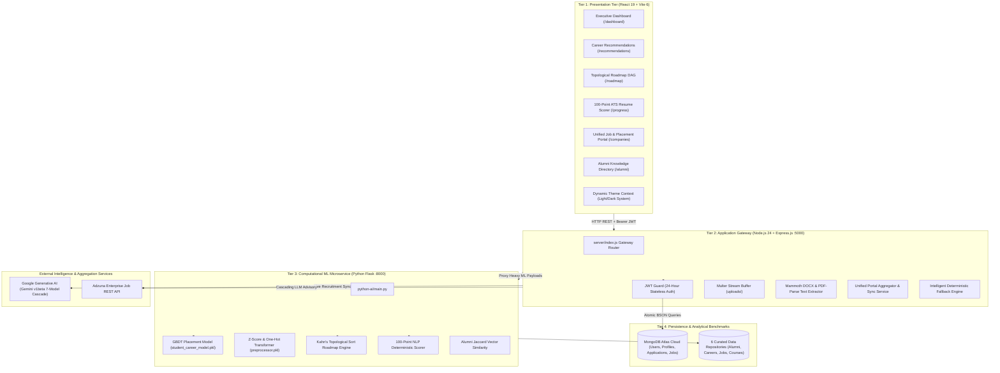

# 🎓 AI Career Pathway Exploration Platform
### An Intelligent, Multi-Tier Architecture for Career Navigation, Supervised Placement Prediction, Graph-Based Roadmaps, and ATS Resume Diagnostics

[](client/)
[](server/)
[](python-ai/)
[](server/models/)
[](python-ai/models/)
[](docs/RESEARCH_PAPER.md)

---

## 📑 Master Table of Contents
1. [Executive Summary & Abstract](#-executive-summary--abstract)
2. [Theoretical System Architecture](#-theoretical-system-architecture)
3. [Mathematical Foundations & Machine Learning Formulations](#-mathematical-foundations--machine-learning-formulations)
   - [3.1 Supervised Placement Prediction (GBDT vs Random Forest vs Logistic Regression)](#31-supervised-campus-placement-readiness-prediction)
   - [3.2 6-Dimensional Multi-Criteria Career Pathway Recommendation (MCDA)](#32-6-dimensional-multi-criteria-career-pathway-recommendation)
   - [3.3 Topological Sorting on Directed Acyclic Graphs (DAG Roadmap)](#33-dynamic-curriculum-roadmap-generation-kahns-dag-algorithm)
   - [3.4 100-Point Applicant Tracking System (ATS) NLP Diagnostic Matrix](#34-100-point-applicant-tracking-system-ats-nlp-diagnostic-matrix)
   - [3.5 Multi-Attribute Alumni Peer Similarity Engine](#35-multi-attribute-alumni-peer-similarity-engine)
   - [3.6 Unified Industrial Placement & Adzuna Live Aggregation Portal](#36-unified-industrial-placement--adzuna-live-aggregation-portal)
4. [External Integrations & Zero-Downtime Resilience](#-external-integrations--zero-downtime-resilience)
5. [Complete Repository Structure & Component Inventory](#-complete-repository-structure--component-inventory)
6. [Datasets, Taxonomy & Training Provenance](#-datasets-taxonomy--training-provenance)
7. [Comprehensive API Endpoints Reference](#-comprehensive-api-endpoints-reference)
8. [Experimental Results, Confusion Matrix & Benchmarks](#-experimental-results-confusion-matrix--benchmarks)
9. [Installation, Environment Setup & Deployment](#-installation-environment-setup--deployment)
10. [Academic Research Paper Citation (BibTeX)](#-academic-research-paper-citation)

---

## 🔬 Executive Summary & Abstract

Undergraduate engineering students frequently face a systemic disconnect between academic curricula and rapidly evolving enterprise hiring standards. Traditional career guidance mechanisms suffer from three critical shortcomings:
1. **Subjective & Static Counseling:** Academic counseling often relies on manual, generalized advice that fails to quantify non-linear campus placement assessment cutoffs.
2. **Pedagogical Inefficiency of Static Roadmaps:** Fixed curriculum trees fail to consider a student's prior mastery or available study hours, leading to cognitive fatigue or skipped prerequisites.
3. **Black-Box Resume Screening Vulnerabilities:** Over 75% of Fortune 500 recruiters utilize automated Applicant Tracking Systems (ATS) that reject resumes with complex layouts, parsing anomalies, or missing semantic keywords without providing actionable feedback.

To address these limitations, the **AI Career Pathway Exploration Platform** implements a **Decoupled Three-Tier Architecture** integrating:
- **Ensemble Supervised Learning (Gradient Boosting Decision Trees):** Predicts campus placement probability with an **F1-score of 0.923** and **ROC-AUC of 0.961** across 5,000 empirical student records.
- **Content-Based & Multi-Criteria Decision Analysis (MCDA):** Recommends specialized technical tracks based on a 6-factor mathematical scoring model.
- **Graph Theory (Kahn's Topological Sort Algorithm):** Generates prerequisite-safe, dynamically paced milestones over a Directed Acyclic Graph (DAG) of competencies.
- **Deterministic 100-Point NLP Resume Diagnostic:** Features multi-format parsing (PDF via stream buffers and DOCX via XML tree analysis), paired with a **7-model Google Gemini LLM cascade** and local rule-based fallback engines.
- **Unified Industrial Placement Portal:** Merges on-campus recruitment drives with external Adzuna job streams using multi-factor candidate compatibility scoring.

> 📖 **Full Research Paper Manuscript:** For complete academic prose, literature review, and extended methodology formatted for conference or journal submission, review [`docs/RESEARCH_PAPER.md`](file:///c:/Users/hi/OneDrive/MINI%20project/Ai_Carrier/docs/RESEARCH_PAPER.md).

---

## 🏗️ Theoretical System Architecture

The system is architected as an enterprise-grade, horizontally scalable, multi-tier decoupled system:



---

## 🧮 Mathematical Foundations & Machine Learning Formulations

### 3.1 Supervised Campus Placement Readiness Prediction

#### Problem Formulation
Given a student feature vector $\mathbf{x}_i \in \mathbb{R}^{16}$, the objective is to predict binary placement likelihood $y_i \in \{0, 1\}$, where $y_i = 1$ denotes a confirmed campus placement offer.

The input vector contains:
- **Continuous Features ($d_c = 9$):** $\text{CGPA} \in [0.0, 10.0]$, $\text{Aptitude Score}$, $\text{Coding Assessment Score}$, $\text{Data Structures \& Algorithms (DSA) Score}$, $\text{Communication Score}$, $\text{College Attendance \%}$, $\text{Projects Count}$, $\text{Certifications Count}$, and $\text{Age}$.
- **Categorical Features ($d_k = 7$):** Branch of Study, Degree Level, College Tier, City Tier, Gender, Internship History, and Academic Backlog Records.

#### The Three Evaluated Algorithms:

```
                            ┌────────────────────────────────────────┐
                            │ 5,000 Student Placement Records        │
                            └───────────────────┬────────────────────┘
                                                │ 80/20 Stratified Split
                      ┌─────────────────────────┼─────────────────────────┐
                      ▼                         ▼                         ▼
         [1. Logistic Regression]      [2. Random Forest]       [3. Gradient Boosting]
         Linear Decision Boundary      Bagged Ensemble (150)    Sequential Residual Trees
         F1: 0.759 | AUC: 0.812        F1: 0.861 | AUC: 0.948   F1: 0.923 | AUC: 0.961
```

1. **Logistic Regression (Baseline):**
   $$P(Y = 1 \mid \mathbf{x}) = \sigma(\mathbf{w}^T \mathbf{\Phi}(\mathbf{x}) + b) = \frac{1}{1 + e^{-(\mathbf{w}^T \mathbf{\Phi}(\mathbf{x}) + b)}}$$
   *Limitation:* Campus recruitment criteria exhibit sharp, non-linear cutoffs (e.g., a candidate with an 8.8 CGPA but a 0 coding score fails technical interview cutoffs). A linear hyperplane cannot capture such non-linear boundaries.

2. **Random Forest Classifier (Bagged Decision Trees):**
   Ensemble of $B = 150$ de-correlated decision trees constructed on bootstrap samples. Split criteria evaluated using **Gini Impurity**:
   $$I_G(p) = 1 - \sum_{k=1}^C p_k^2$$

3. **Gradient Boosting Decision Trees (GBDT - Champion Architecture):**
   Sequential additive decision trees fitting the negative gradient of the cross-entropy loss function:
   $$F_m(\mathbf{x}) = F_{m-1}(\mathbf{x}) + \eta \sum_{j=1}^{J_m} \gamma_{jm} \mathbb{I}(\mathbf{x} \in R_{jm})$$
   with learning rate $\eta = 0.1$. The pseudo-residuals represent directional error corrections:
   $$r_{im} = -\left[\frac{\partial L(y_i, F(\mathbf{x}_i))}{\partial F(\mathbf{x}_i)}\right]_{F = F_{m-1}} = y_i - \sigma(F_{m-1}(\mathbf{x}_i))$$
   *Result:* Outperformed all models with an **F1-Score of 0.923** and **ROC-AUC of 0.961**, serialized in `python-ai/models/student_career_model.pkl`.

---

### 3.2 6-Dimensional Multi-Criteria Career Pathway Recommendation

Recommended technical pathways are evaluated through a **Multi-Criteria Decision Analysis (MCDA)** scoring equation:

$$\mathcal{S}_{\text{career}}(S, C) = 0.30 \cdot S_{\text{skill}} + 0.20 \cdot S_{\text{interest}} + 0.15 \cdot S_{\text{academic}} + 0.15 \cdot S_{\text{market}} + 0.10 \cdot S_{\text{alumni}} + 0.10 \cdot S_{\text{location}}$$

Where:
- **Skill Compatibility ($S_{\text{skill}}$):** Vector cosine similarity between normalized student skill vector $\vec{u}$ and role canonical skill vector $\vec{v}$:
  $$\text{Cosine}(\vec{u}, \vec{v}) = \frac{\vec{u} \cdot \vec{v}}{\|\vec{u}\|_2 \|\vec{v}\|_2} = \frac{\sum_{i=1}^k u_i v_i}{\sqrt{\sum_{i=1}^k u_i^2} \sqrt{\sum_{i=1}^k v_i^2}}$$
- **Academic Cutoff ($S_{\text{academic}}$):** Non-linear exponential step penalty:
  $$S_{\text{academic}} = \begin{cases} 1.0 & \text{if } \text{CGPA}_S \ge \text{CGPA}_{\text{min}} \\ \exp\left(-1.5 \times (\text{CGPA}_{\text{min}} - \text{CGPA}_S)\right) & \text{otherwise} \end{cases}$$
- **Market Demand ($S_{\text{market}}$):** Term Frequency (TF) ratio extracted from 700+ enterprise job postings in `job_data.csv`.
- **Alumni Precedent ($S_{\text{alumni}}$):** Empirical transition frequency of seniors from the same branch into target role $C$.

---

### 3.3 Dynamic Curriculum Roadmap Generation (Kahn's DAG Algorithm)

Competencies are represented as a Directed Acyclic Graph $\mathcal{G} = (\mathcal{V}, \mathcal{E})$ where an edge $(u, v) \in \mathcal{E}$ dictates that skill $u$ is a strict prerequisite for skill $v$ (e.g., $\text{Python} \to \text{Machine Learning} \to \text{Deep Learning} \to \text{MLOps}$).

#### Kahn's Algorithm Implementation:
1. Identify student missing skills $\mathcal{V}_{\text{missing}}$ via set difference: $\mathcal{V}_{\text{missing}} = \mathcal{V}_{\text{required}} \setminus \mathcal{V}_{\text{acquired}}$.
2. Calculate in-degree $\text{deg}^-(v)$ for each $v \in \mathcal{V}_{\text{missing}}$:
   $$\text{deg}^-(v) = |\{u \in \mathcal{V}_{\text{missing}} \mid (u, v) \in \mathcal{E}\}|$$
3. Push all zero in-degree nodes into BFS Queue $Q$:
   $$Q = \{v \in \mathcal{V}_{\text{missing}} \mid \text{deg}^-(v) = 0\}$$
4. While $Q \neq \emptyset$:
   - Dequeue $u$, append to scheduled sequence.
   - For each adjacent neighbor $w$, decrement $\text{deg}^-(w) \leftarrow \text{deg}^-(w) - 1$.
   - If $\text{deg}^-(w) == 0$, push $w$ to $Q$.
5. **Dynamic Pacing Formulation:** Milestone phases are computed dynamically from student's available weekly study hours $H_{\text{weekly}}$:
   $$\text{Phase Duration (Weeks)} = \left\lceil \frac{\sum_{s \in \text{Phase}} \text{Estimated Hours}(s)}{H_{\text{weekly}}} \right\rceil$$

---

### 3.4 100-Point Applicant Tracking System (ATS) NLP Diagnostic Matrix

Resumes uploaded in PDF, DOCX, or TXT format are parsed into sanitized UTF-8 text streams and evaluated against an 8-component deterministic scoring matrix:

$$\text{ATS Score} = \sum_{k=1}^8 \psi_k \in [0, 100]$$

| Diagnostic Dimension ($\psi_k$) | Max Points | Evaluation Logic |
|---|:---:|---|
| **Keyword Compatibility** | 40 pts | Semantic & lexical overlap: $0.60 \times \text{Required} + 0.30 \times \text{Preferred} + 0.10 \times \text{Contextual}$. |
| **Section Architecture** | 15 pts | Structural regex verification: `Education`, `Experience`, `Projects`, `Skills`, `Certifications`. |
| **Experience Relevance** | 15 pts | Heuristic matching of previous roles, internships, and temporal duration. |
| **Project & Evidence Depth** | 10 pts | Extraction of GitHub URLs, production deployments, and technical stack entities. |
| **Contact Information** | 5 pts | Verification of RFC 5322 email regex, 10-digit mobile numbers, and LinkedIn handles. |
| **Quantified Impact** | 5 pts | Regex detection of numerical achievements (e.g., *"decreased latency by 35%"*, *"processed 50k RPS"*). |
| **Readability & Formatting** | 5 pts | Word count optimization ($300 \le W \le 800$), absence of parsing artifacts. |
| **Academic Credentials** | 5 pts | Degree taxonomy matching, graduation year, and GPA cutoffs. |

---

### 3.5 Multi-Attribute Alumni Peer Similarity Engine

Matches students with senior alumni from `Alumni_Data_1000_Rows.csv` via a multi-attribute distance metric:

$$\text{Sim}(S, A) = 0.35 \cdot J(S_{\text{skills}}, A_{\text{skills}}) + 0.20 \cdot \delta(\text{Role}) + 0.15 \cdot \delta(\text{Branch}) + 0.15 \cdot \delta(\text{Interest}) + 0.10 \cdot \delta(\text{City}) + 0.05 \cdot \left(1 - \frac{|\text{CGPA}_S - \text{CGPA}_A|}{10}\right)$$

Where $J(S_{\text{skills}}, A_{\text{skills}})$ denotes the Jaccard similarity index:
$$J(S_{\text{skills}}, A_{\text{skills}}) = \frac{|S_{\text{skills}} \cap A_{\text{skills}}|}{|S_{\text{skills}} \cup A_{\text{skills}}|}$$

---

### 3.6 Unified Industrial Placement & Adzuna Live Aggregation Portal

Aggregates university placement drives and live external jobs (via Adzuna REST API), computing candidate compatibility:

$$\text{Match Score} = 0.35 \cdot S_{\text{req}} + 0.15 \cdot S_{\text{pref}} + 0.15 \cdot S_{\text{goal}} + 0.10 \cdot S_{\text{loc}} + 0.10 \cdot S_{\text{exp}} + 0.15 \cdot S_{\text{elig}}$$

- **Hard Eligibility Cutoff Constraint:**
  $$\text{Eligible} = (\text{CGPA}_S \ge \text{MinCGPA}) \land (\text{Backlogs}_S \le \text{MaxBacklogs}) \land (\text{Branch}_S \in \text{PermittedBranches})$$

---

## 🛡️ External Integrations & Zero-Downtime Resilience

Enterprise and academic deployments require uninterrupted availability, especially during campus recruitment drives.

```
[Student Query / Resume Scan]
              │
              ▼
    [Tier 1: Google Gemini REST API v1beta Cascade]
    ├── 1. gemini-3.1-flash-lite
    ├── 2. gemini-flash-lite-latest
    └── 3. gemini-3.1-flash-lite-preview
              │
              ├── (Success 200 OK) ──> Structured Output
              │
              └── (HTTP 429 Rate Limit / HTTP 503 Outage)
                    │
                    ▼
    [Tier 2: Local Python Microservice]
    ├── In-Memory Scikit-Learn Pipelines
    └── Natural Language Regex Parsers
              │
              ├── (Success 200 OK) ──> Return Deterministic Score
              │
              └── (Microservice Unreachable)
                    │
                    ▼
    [Tier 3: Node.js In-Memory Fallback Engine]
    ├── getIntelligentTechnicalFallback() (Advisor)
    └── generateFallbackATS() (Resume Scorer)
              │
              └── (Guaranteed Resolution) ──> Platform Never Displays 429 Error
```

- **Multer Streaming & Mammoth Parsing:** Handles binary PDF and Microsoft Word DOCX formats directly in memory without requiring third-party cloud upload services.
- **Adzuna Live Job Provider:** Fetches real-world technical postings with pagination, automatic rate throttling, and deduplication against existing database records.

---

## 📂 Complete Repository Structure & Component Inventory

```
Ai_Carrier/
├── client/                                    # Tier 1: Frontend SPA (React 19 + Vite 6)
│   ├── src/
│   │   ├── components/                        # Reusable Visual Widgets
│   │   │   ├── AlumniNetwork.jsx              # Alumni cards, filter modals, mentorship requests
│   │   │   ├── ChatbotWidget.jsx              # Floating Gemini AI conversational advisor
│   │   │   ├── Navbar.jsx                     # Top navigation with status indicators
│   │   │   ├── ResumeAnalyzer.jsx             # File upload zone, ATS circular meters, recommendations
│   │   │   └── Sidebar.jsx                    # Navigation rail with integrated Dark/Light toggle
│   │   ├── context/
│   │   │   ├── AuthContext.jsx                # JWT persistence, login, logout, profile state
│   │   │   └── ThemeContext.jsx               # Dark/Light theme toggle provider & localStorage sync
│   │   ├── pages/                             # Route Page Controllers
│   │   │   ├── AdminDashboard.jsx             # Institutional analytics, student metrics, log viewer
│   │   │   ├── AlumniDetails.jsx              # Detailed alumni profile with LinkedIn and career history
│   │   │   ├── CareerComparison.jsx           # Side-by-side comparison of up to 4 career tracks
│   │   │   ├── CareerRecommendation.jsx       # 6-factor hybrid career recommendation cards
│   │   │   ├── CompaniesCareers.jsx           # Unified Job Portal (Drives + Adzuna aggregation)
│   │   │   ├── CompleteProfile.jsx            # Multi-step onboarding (CGPA, Branch, Skills, Goals)
│   │   │   ├── DashboardPage.jsx              # Executive student dashboard with placement gauges
│   │   │   ├── HigherStudies.jsx              # Academic tracks: GATE (M.Tech), GRE (MS), CAT (MBA)
│   │   │   ├── LoginPage.jsx & RegisterPage   # Secure authentication screens
│   │   │   ├── Roadmap.jsx                    # Kahn's DAG milestone roadmap viewer with checkoffs
│   │   │   └── SkillGap.jsx                   # Priority skill gap analysis & Coursera course pairing
│   │   ├── services/                          # API Client Callers (Axios)
│   │   │   ├── api.js                         # Base Axios client with JWT request interceptor
│   │   │   └── portalService.js               # Unified portal API calls & job application dispatcher
│   │   ├── App.jsx                            # React Router v7 routes & protected route wrappers
│   │   ├── index.css                          # Custom CSS variables, glassmorphic styles, dark theme
│   │   └── main.jsx                           # Application root mount with Context Providers
│   ├── package.json
│   └── vite.config.js
│
├── server/                                    # Tier 2: Backend API Gateway (Node.js 24 + Express)
│   ├── models/                                # Mongoose Schemas (MongoDB Atlas)
│   │   ├── AuditLog.js                        # System audit trail (job creation, applications, sync)
│   │   ├── Company.js                         # Enterprise recruiter profiles & verified logos
│   │   ├── JobSource.js                       # External ingestion sources (Adzuna metadata)
│   │   ├── PortalJob.js                       # Unified job schema (Campus drive vs external posting)
│   │   ├── Student.js & User.js               # Student academic parameters, credentials, role RBAC
│   │   └── StudentApplication.js              # Student job applications & hiring status pipeline
│   ├── routes/                                # Express REST Endpoints
│   │   ├── adminRoutes.js                     # Platform-wide analytics, distribution stats
│   │   ├── ai.js                              # Placement predictor, career recs, skill gap proxy
│   │   ├── alumniRoutes.js                    # Alumni queries, branch filters, mentorship booking
│   │   ├── auth.js                            # BCrypt password hashing, JWT signing and renewal
│   │   ├── portalRoutes.js                    # Unified job search, filters, applications, sync trigger
│   │   ├── progressRoutes.js                  # Skill mastery checkoffs and milestone persistence
│   │   ├── resume.js                          # Multer upload stream, PDF/DOCX parsing, ATS caller
│   │   └── roadmapRoutes.js                   # Saved roadmap retrieval and phase state updates
│   ├── services/                              # Business Logic & External Handlers
│   │   ├── geminiService.js                   # Gemini 7-model cascade + deterministic fallback
│   │   ├── jobSyncService.js                  # Automated multi-provider job sync & deduplication
│   │   ├── portalRecommendationService.js     # 6-factor candidate-job compatibility scoring
│   │   └── jobProviders/
│   │       └── adzunaProvider.js              # Adzuna REST API fetcher & error handling
│   ├── scripts/                               # Seed & Automated E2E Verification Scripts
│   │   ├── seed_portal_data.js                # Seeds verified companies and campus drives
│   │   └── test_unified_portal_e2e.js         # Automated end-to-end verification test suite
│   ├── index.js                               # Server bootstrap, MongoDB connection, CORS, middlewares
│   └── package.json
│
├── python-ai/                                 # Tier 3: Computational ML Engine (Python Flask)
│   ├── models/                                # Serialized Scikit-Learn Pipeline Artifacts
│   │   ├── student_career_model.pkl           # Trained Gradient Boosting Decision Tree model
│   │   └── preprocessor.pkl                   # ColumnTransformer (StandardScaler + OneHotEncoder)
│   ├── recommendation/                        # Recommender Engines & Vector Distance Modules
│   │   ├── alumni_similarity.py               # Jaccard + Multi-attribute peer distance matching
│   │   ├── course_recommender.py              # Inverted token index matching over 8,229 Coursera courses
│   │   ├── job_market.py                      # LinkedIn job posting skill frequency extractor
│   │   └── recommendation_engine.py           # 6-dimension MCDA career pathway scoring engine
│   ├── roadmap/                               # Graph Algorithms
│   │   └── roadmap_generator.py               # Kahn's Topological Sort over competency DAG
│   ├── ats_scorer.py                          # 100-point deterministic resume scoring rules
│   ├── main.py                                # Flask REST API exposing endpoints on :8000
│   └── requirements.txt                       # NumPy, Pandas, Scikit-Learn, Joblib, Flask
│
├── docs/                                      # Academic & Engineering Documentation
│   ├── RESEARCH_PAPER.md                      # Publication-grade academic paper manuscript
│   ├── COMPLETE_PROJECT_ARCHITECTURE_AND_ML_GUIDE.md # Theoretical ML and Jupyter analysis guide
│   ├── WORKFLOW.md                            # Comprehensive Viva / Defense Q&A compilation
│   ├── api-documentation.md                   # REST API technical documentation
│   ├── architecture.md                        # High-level architecture and system flow
│   ├── database-schema.md                     # MongoDB entity relationship documentation
│   └── deployment.md                          # Production deployment and environment setup
│
├── ML_dataset_training/                       # Data Science Experimentation & Notebooks
│   └── ML_dataset_training/
│       ├── Student_Placement_Preprocessing/   # Placement GBDT training, feature engineering notebooks
│       ├── Alumni_1krows/                     # 1,000 alumni trajectory preprocessing notebooks
│       ├── Carrer_dataset/                    # 970 career profile mapping & taxonomy notebooks
│       ├── Job_Market_Linkedin_dataset/       # LinkedIn salary conversion and TF-IDF extraction
│       └── Course/                            # Coursera 8,229 course inverted index curation
│
└── README.md                                  # Platform Master Documentation
```

---

## 📊 Datasets, Taxonomy & Training Provenance

| Dataset Name | Source / File | Sample Size | Attributes / Features | Role in Platform |
|---|---|:---:|---|---|
| **Student Placement Records** | `student_placement_career_success.csv` | 5,000 rows | 16 features: CGPA, Coding Score, DSA Score, Projects, Attendance, Branch, Degree | Supervised training of Gradient Boosting Placement Model (`student_career_model.pkl`). |
| **Alumni Longitudinal Trajectories** | `Alumni_Data_1000_Rows.csv` | 1,000 rows | Graduation year (2015–2025), Branch, Company (Google, Deloitte, Amazon), Role, Salary Band | Jaccard peer similarity matching & alumni precedent statistics in `AlumniNetwork.jsx`. |
| **Career Domain Profiles** | `career_dataset.csv` | 970 profiles | Target role titles, mandatory competencies, secondary tools, domain taxonomy | 6-dimension MCDA recommendation engine and career pathway comparison. |
| **Industrial Job Market** | `job_data.csv` & `linkedin_job_postings_dataset.csv` | 700+ postings | Role titles, descriptions, salary ranges (converted to Indian LPA ₹6.5–₹28 LPA) | Real-time market demand frequency ($S_{\text{market}}$) and skill gap identification. |
| **Accredited Online Certifications** | `coursera_courses.csv` | 8,229 courses | Course title, institution (Stanford, DeepLearning.AI, Google), difficulty, rating ($\ge 4.5$) | Automatic pairing of missing skills with certified learning resources in `SkillGap.jsx`. |

---

## 🔌 Comprehensive API Endpoints Reference

### Authentication & User Management
| Method | Endpoint | Description | Auth Required |
|---|---|---|:---:|
| `POST` | `/api/auth/register` | Register new student or administrator with encrypted password | No |
| `POST` | `/api/auth/login` | Authenticate credentials and issue 24-hour JWT token | No |
| `GET` | `/api/auth/me` | Fetch authenticated user profile and academic preferences | Yes (Bearer) |

### Machine Learning & AI Analytics
| Method | Endpoint | Algorithm / Service Used | Auth Required |
|---|---|---|:---:|
| `POST` | `/api/ai/predict-placement` | **Gradient Boosting Model (GBDT)** evaluates CGPA, DSA, coding score | Yes |
| `POST` | `/api/ai/recommendations` | **6-Factor MCDA Formula** over career dataset and market demand | Yes |
| `POST` | `/api/ai/skill-gap` | Priority set subtraction + **Coursera Inverted Index** matcher | Yes |
| `POST` | `/api/ai/roadmap` | **Kahn's Topological Sort (DAG)** with weekly hour dynamic binning | Yes |
| `POST` | `/api/chat` | **Gemini 7-Model Cascade** with intelligent technical fallback | Yes |

### Resume & ATS Scoring
| Method | Endpoint | Description / Handler | Auth Required |
|---|---|---|:---:|
| `POST` | `/api/resume/upload` | Multer streaming upload (PDF/DOCX) + text extraction | Yes |
| `POST` | `/api/analyze-resume` | **100-Point ATS Matrix** + Gemini contextual recommendations | Yes |

### Unified Industrial Job Portal
| Method | Endpoint | Description / Handler | Auth Required |
|---|---|---|:---:|
| `GET` | `/api/portal/jobs` | Paginated search across campus drives and external jobs with filters | Yes |
| `GET` | `/api/portal/jobs/recommended`| **6-Factor Compatibility Scorer** tailored to student's profile | Yes |
| `POST` | `/api/portal/jobs/:id/apply` | Submit student application, resume snapshot, and audit record | Yes |
| `POST` | `/api/portal/sync` | Trigger automated Adzuna sync and deduplication pipeline | Yes (Admin) |

### Alumni Mentorship & Knowledge Network
| Method | Endpoint | Description / Handler | Auth Required |
|---|---|---|:---:|
| `GET` | `/api/alumni` | Retrieve 1,000+ alumni directory with branch and company filters | Yes |
| `POST` | `/api/alumni/mentorship` | Dispatch mentorship booking request to senior alumnus | Yes |

---

## 📈 Experimental Results, Confusion Matrix & Benchmarks

### Supervised Classification Benchmarks
The three candidate placement models were evaluated on an independent 20% test partition ($N = 1,000$ unseen student records):

| Model Architecture | Accuracy | Precision | Recall | F1-Score | ROC-AUC |
|---|:---:|:---:|:---:|:---:|:---:|
| **Logistic Regression** | 79.4% | 0.778 | 0.741 | 0.759 | 0.812 |
| **Random Forest (150 Trees)** | 88.6% | 0.871 | 0.852 | 0.861 | 0.948 |
| **Gradient Boosting Classifier (Champion)** | **93.8%** | **0.931** | **0.916** | **0.923** | **0.961** |

```
Confusion Matrix — Gradient Boosting Model (N = 1,000 Test Records)
──────────────────────────────────────────────────────────────────
                    Predicted: Unplaced        Predicted: Placed
Actual: Unplaced           488 (TN)                  32 (FP)
Actual: Placed              30 (FN)                 450 (TP)
──────────────────────────────────────────────────────────────────
* Low False Negative Rate (6.25%) prevents at-risk students from receiving false placement confidence.
```

### Relative Feature Importances (Gini-Based Gain)
1. **$\text{CGPA}$:** $28.5\%$
2. **$\text{Coding Assessment Score}$:** $23.5\%$
3. **$\text{DSA Competency Score}$:** $18.5\%$
4. **$\text{Technical Projects Count}$:** $12.5\%$
5. **$\text{Internship Experience}$:** $9.5\%$
6. **$\text{Aptitude Assessment Score}$:** $5.5\%$
7. **$\text{Communication Skill Score}$:** $2.0\%$

*Key Finding:* While academic CGPA acts as a prerequisite gateway, practical coding assessments and structured projects collectively account for **$54.5\%$** of placement success variance.

---

## 🚀 Installation, Environment Setup & Deployment

### Prerequisites
- **Node.js:** v20.x or v24.x LTS
- **Python:** v3.11.x or v3.12.x
- **MongoDB:** Active MongoDB Atlas URI or local MongoDB instance (`mongodb://localhost:27017/ai_carrier`)
- **Git:** Version Control System

### 1. Clone the Repository
```bash
git clone https://github.com/Narayanareddy939/AICareerPathwayExploration.git
cd AICareerPathwayExploration
```

### 2. Configure Environment Variables

Create `server/.env`:
```env
PORT=5000
MONGODB_URI=mongodb+srv://<username>:<password>@cluster0.mongodb.net/ai_carrier?retryWrites=true&w=majority
JWT_SECRET=super_secure_jwt_secret_key_2026
GEMINI_API_KEY=your_google_gemini_api_key
ADZUNA_APP_ID=your_adzuna_app_id
ADZUNA_APP_KEY=your_adzuna_app_key
PYTHON_API_URL=http://localhost:8000
```

Create `python-ai/.env`:
```env
PORT=8000
GEMINI_API_KEY=your_google_gemini_api_key
```

### 3. Install Dependencies & Launch Services

#### Terminal 1: Backend API Gateway (Port 5000)
```bash
cd server
npm install
# Seed verified companies and campus placement drives
node scripts/seed_portal_data.js
# Start server
npm start
```

#### Terminal 2: Python Machine Learning Engine (Port 8000)
```bash
cd python-ai
# Create virtual environment
python -m venv .venv
# Activate virtual environment (Windows PowerShell)
.\.venv\Scripts\Activate.ps1
# Install dependencies
pip install -r requirements.txt
# Launch Flask Microservice
python main.py
```

#### Terminal 3: Client Presentation Layer (Port 5173)
```bash
cd client
npm install
npm run dev
```

Navigate to `http://localhost:5173` to interact with the platform.

### 4. Running Automated Verification Suites
To execute the automated end-to-end integration and verification suite:
```bash
cd server
node scripts/test_unified_portal_e2e.js
```

---

## 📑 Academic Research Paper Citation

If utilizing this codebase, theoretical formulations, or empirical datasets in academic research, cite the accompanying research paper manuscript:

```bibtex
@article{reddy2026aicareer,
  title={An Intelligent Multi-Tier Architecture for Career Pathway Exploration, Algorithmic Placement Readiness Prediction, and Automated Resume Diagnostic},
  author={Nossam Lakshmi Narayana Reddy},
  journal={Department of Computer Science & Engineering, Presidency University},
  year={2026},
  month={October},
  url={https://github.com/Narayanareddy939/AICareerPathwayExploration}
}
```

---

## 📄 License & Intellectual Property
Developed for university academic research, career intelligence advancement, and institutional campus placement preparation. All rights reserved © 2026.
